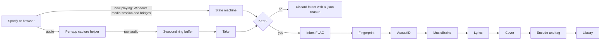

# How Mynaphone works

This page explains the design so that the behavior you see makes sense. You don't need any of it to
use the app.

## From a playing song to a filed one

Recording and the verdict happen on your PC with no network. A kept take waits in the inbox until
the lookups from AcoustID onward can reach the internet.

## Capturing one app's audio

Windows can hand an application the audio stream of one other process. That facility, called process
loopback, arrived with Windows 10 version 2004. Microsoft documents it as the
[process loopback activation type](https://learn.microsoft.com/en-us/windows/win32/api/audioclientactivationparams/ne-audioclientactivationparams-audioclient_activation_type)
and shows it in its [application loopback sample](https://learn.microsoft.com/en-us/samples/microsoft/windows-classic-samples/applicationloopbackaudio-sample/).

Mynaphone's helper, a 300-line C# program in [`helper/ProcessLoopback.cs`](../helper/ProcessLoopback.cs), asks Windows for Spotify's stream, or a browser's, and
passes it to the app as raw audio. Because only that process's audio is in the stream, a
notification chime, a video in another window or a game cannot get into a recording.

The older "device" mode records the whole output device instead, through Windows'
[loopback recording](https://learn.microsoft.com/en-us/windows/win32/coreaudio/loopback-recording). In that mode a monitor watches every
app's audio session and rejects a take if anything else made a sound while it ran.

The app keeps the last 3 seconds of audio in memory at all times. Windows reports a track change 1
to 3 seconds after the audio has switched, so when the notice arrives the recorder reaches back into
that buffer to the moment the song began. Leading silence is trimmed afterwards.

## Knowing what is playing

The recorder has 3 sources of information, each more detailed than the last.

The Windows media session comes first. Every modern media app tells Windows its title, artist, album,
cover, playback state and position, which is the same data the media keys and the volume flyout use.
It works for Spotify, browsers and most players, and it is the recorder's clock for starts, ends,
pauses and seeks. Mynaphone reads it through Windows'
[media session manager API](https://learn.microsoft.com/en-us/uwp/api/windows.media.control.globalsystemmediatransportcontrolssessionmanager).

The Spotify bridge adds what Windows doesn't know. It is optional and needs [Spicetify](https://spicetify.app)
installed. A Spicetify extension inside Spotify, [`spicetify/mynaphone.js`](../spicetify/mynaphone.js), reports the
exact track id and album id, the track and disc numbers, and the quality tier the song played at.
It also passes on buffering, Spotify's own synced lyrics, album facts such as the release date
and label, whether the item playing is an ad, and which device Spotify Connect plays it on, all over a
local WebSocket. The app can ask the
extension for your playlists and their songs, and, when you record a playlist, have it play the
playlist from a given song and pause it at the end.

YouTube gets the same treatment from the browser extension in [`browser-extension/`](../browser-extension/),
which you load by hand into Chrome, Edge, Brave, Vivaldi, or Opera. On a YouTube page it reports the video id,
whether YouTube marks the video as music, and every play, pause, seek and speed change. On YouTube
Music it also reads the artist, album and year from the player bar.

The extension can't reliably tell which browser it runs in, since several of them send Chrome's user
agent. So the bridge asks Windows which program owns each connection and keeps each browser's
reports apart. A track playing in Brave records only when the extension in Brave says it's music.

## Deciding whether a take is kept

A take is kept only if all of these are true:

- The recorder saw the song within about 1.5 seconds of its start.
- Playback was never paused or seeked, and never ran faster or slower than normal speed.
- No buffering stall was reported, and the wall-clock time from start to end matches the song's
  reported duration within 1.5 seconds. A stall on a weak connection makes the take run long.
- The capture reported no dropouts and the output device did not change.
- The recorded length matches the reported duration within 1.5 seconds.
- The app's slider in the Windows Volume Mixer and the app's own volume control were at 100 % when
  the take started. The Windows master volume and mute don't affect per-app capture, so they're ignored.
- In device mode, no other app made a sound.

Every take, kept or not, is logged with its measurements, so you can see why a verdict went the way
it did and the rules can be revisited later. The [troubleshooting guide](troubleshooting.md#every-discard-reason)
lists every reason a take can be discarded.

## Noticing when no sound arrives

Spotify can say it's playing while none of its sound reaches Mynaphone, for example when it's muted
in the Windows Volume Mixer or Spotify Connect plays the song on another device. When a song has
played for 15 seconds and Mynaphone still hasn't heard a sound, it warns you on the Status page, with
one Windows notification, and in the tray icon's tooltip.

Those 15 seconds are the song's own, read from the position Spotify reports, so a pause, an ad, or
Spotify loading the song never adds to them. They start over with each song and each time you resume.
Any sound in between means the song is fine, so a quiet stretch later in a song, such as the silence
before a hidden track, doesn't set it off. The warning stays until sound comes back, however many
songs that takes.

The warning names the first cause it finds, in this order:

1. Spotify Connect plays the song on another device. Only the Spotify bridge can tell this one.
2. Mynaphone's per-app capture isn't attached to the app.
3. The app is muted, or at 0, in the Windows Volume Mixer.
4. The player's own volume is at 0.
5. The app sends Windows no audio at all. Spotify's exclusive mode should cause this, since
   [Windows' loopback recording](https://learn.microsoft.com/en-us/windows/win32/coreaudio/loopback-recording)
   works only with shared-mode audio, though that's untested.
6. The app sends audio, and all of it is silence.

Mynaphone discards a song that plays while the warning stands, and its reasons on the Activity page
start with what the warning found. When only silence arrives, it discards the song only if the whole
recording turns out silent, because a song that opens quietly looks the same early on. To turn the
warning off, set `silence_warning_seconds` to `0` in `config.toml`.

## Identifying the song

Identification runs in 6 steps.

1. [Chromaprint](https://acoustid.org/chromaprint) computes an acoustic fingerprint of the first 2 minutes of the recording.
2. [AcoustID](https://acoustid.org/webservice) matches the fingerprint against its database and returns MusicBrainz recording and
   release ids with a confidence score. This step needs the free application key entered on the
   Set up page; without it the recorder goes straight to step 5. Among candidate releases, the one whose album title matches
   what Spotify reported wins. Failing that, an ordinary album beats a compilation.
3. The [MusicBrainz API](https://musicbrainz.org/doc/MusicBrainz_API) supplies the release (label, catalog number, barcode, country, date, type, genres,
   track and disc numbers), the recording (ISRC, singers and performers) and the linked work
   (composer, lyricist, language).
4. Spotify's own facts fill in whatever is still missing, among them the release date, explicit
   flag, popularity, copyright line and ISRC.
5. When nothing matched, the recorder falls back on the capture's own tags. A text rule recognizes
   soundtrack albums from phrases such as "Original Motion Picture Soundtrack" and "From ...", and
   treats the album artist of a soundtrack as its composer. For YouTube captures, the YouTube Music
   catalog supplies album, year and track number, through [ytmusicapi](https://github.com/sigma67/ytmusicapi).
6. The genre comes from the first source that has one: Apple's catalog through the
   [iTunes Search API](https://performance-partners.apple.com/search-api), then MusicBrainz, then
   Last.fm's tags through the [Last.fm API](https://www.last.fm/api) when you've added a Last.fm key. Only tags that are genre names count, so tags
   like "seen live" never become a genre. A soundtrack still without a genre after that gets
   Soundtrack. A genre you type in the Library editor always wins.

## Lyrics and cover art

Spotify's own lyrics come first when the bridge supplied them, because they match the exact
recording and cover languages that LRCLIB often lacks. Otherwise the app asks [LRCLIB](https://lrclib.net/docs) by title,
artist, album and duration. Synced lyrics go into the file's lyrics tag and into a `.lrc` file next
to it, because some players read one and some read the other. Cover art comes from the capture,
which includes Spotify's 640 px image, and failing that from the [Cover Art Archive](https://musicbrainz.org/doc/Cover_Art_Archive/API).

A song has no words, so the app doesn't look up lyrics for it and lyrics and lyricist don't count
as missing, when its title or album says "Instrumental", when MusicBrainz gives it its "no lyrics"
language, when its album is a film's or a game's score, or when nobody is credited for its lyrics or
its singing and at least 3 in 4 of the 5 or more songs from its album in your library have no words
either. LRCLIB also marks some songs as instrumental, and those are treated the same way. Choosing
**No, it has vocals** in the Library editor overrides all of these.

## A song from YouTube that the fingerprint does not know

A video from a label channel such as T-Series or YRF is usually a different edit from the album
recording, so AcoustID can draw a blank. The app then fingerprints again from 45 seconds in, past
any dialogue at the start.

When that fails too, it reads the credits that labels put in the video description. Those lines
name the song, the film, the singers, the lyricist, the music director, the label and the release
date. The YouTube Music catalog then supplies the album, year and track number, and the song is
filed under the film as a soundtrack.

A channel such as YRF is never used as the artist, and a view count is never used as an album.
The browser extension sends that text with each video. Without it, the app reads the public
watch page itself.

## Encoding and filing

The inbox FLAC is a lossless copy of what the app decoded. The recorder encodes it once with [FFmpeg](https://ffmpeg.org), to AAC
256 kbps by default, which plays in cars and on phones at about 9 MB a song. Lossless-tier captures
stay FLAC. The file is then placed by type:

- `Soundtracks/<Album (Year)>/<NN Title>` when MusicBrainz marks the release as a soundtrack or the
  text rule does. Each film gets one folder: its singles, such as `Ratata (From "Leo")`, and a second
  spelling of its album name join the folder of the film's album, without the single's `01`. A dubbed
  album such as `Vettaiyan (telugu)` and a background score keep folders of their own, and so does a
  film of the same name more than 3 years apart. Songs filed apart before are moved in, and every move
  is written to `folder-moves.json` next to the index.
- `Artists/<Album artist>/<Album (Year)>/<NN Title>` for albums.
- `Artists/<Artist>/Singles/<Title>` for singles and EPs.
- `Artists/Various Artists/<Album (Year)>/...` for compilations.
- `Unsorted/<Title>` when nothing told the app who performs the song. The Library page lists these
  under **Needs attention**, and a later lookup or a manual edit moves them.

A film song keeps its singers in the artist tag and its music director in the album-artist and
composer tags, so an A. R. Rahman album remains one folder while each track still names Sonu
Nigam or Shreya Ghoshal. When MusicBrainz credits the recording to the composer and lists the singers only
as vocal performers, the app swaps the singers into the artist tag itself, as long as the player named one of
the singers and none of the credited artists. A band keeps its name that way, since Spotify shows
Metallica, not James Hetfield. Backing and choir singers never go into the artist tag.

All the songs in a film's folder share one album artist. A film's releases on MusicBrainz often credit it
differently. One release of Aashiq Banaya Aapne credits "Himesh Reshammiya & Sameer" and another credits
"Himesh Reshammiya", and a player that groups by album artist would show the film twice. So each song gets
the names every song's credit has, usually the music director, and all of Aashiq Banaya Aapne's songs say
"Himesh Reshammiya". The album artist's sort name and MusicBrainz ids go with it, so a player that sorts by
the sort name keeps the film together too. "Various Artists" counts only when no song names people, and an
album artist you type in the Library editor goes on the film's other songs too. A new song takes its film's album artist when it's
filed. If it names fewer of those people, the whole film keeps the ones they share. Each change to a song
filed earlier is written to `album-artists.json` next to the index.

The songs in a film's folder share one album name too. Each of Leo's 4 singles kept its own name, such as
"Ratata (From “Leo”)", so a player that groups by album name showed Leo 5 times. Now each song gets the
album's own name, spelled the way most of its songs spell it, and a film with only singles gets the
film's name from their "(From ...)". Mynaphone numbers the singles after the album's songs, in the order
they came out, so Leo's are tracks 8 to 11, and their file names stay as they are. A song keeps its own
album and track number in the index too, since they decide its folder, its file name, and its lyrics
lookup. An album or a
track number you type in the Library editor stays, and a typed album goes on the film's other songs too.
Mynaphone writes each change to a song filed earlier to `album-names.json` next to the index.

Tags follow [MusicBrainz Picard's tag mapping](https://picard-docs.musicbrainz.org/en/latest/appendices/tag_mapping.html),
so other players and taggers understand them. [mutagen](https://github.com/quodlibet/mutagen) writes them.

## Playlist files

A playlist or album you record or save from the **Status** page becomes an M3U8 file in the library's
`Playlists` folder, named after the playlist, so the USB export copies it along with the songs. Each line
is the song's path from that folder, such as `../Soundtracks/Leo (2023)/Ratata.m4a`, so the playlist
plays wherever the whole library goes: another drive, a stick, or a phone.

Each Spotify song in the playlist is matched to your file by its Spotify id first, then by the ids of
its other releases that the library knows (its single and its album track, for example), then by
artist, title and length. A song the library doesn't have yet stays in the file as a note line,
`# not in your library yet: Artist - Title`, in the playlist's order, which players skip. The
playlist's song list is kept in the index, and the files are written again whenever a song is filed
or moved, so a line never points at an old path.

While a playlist records, a song you have from another release is matched too. Spotify gives the
song's ISRC a moment after it starts, and when a song in your library has that ISRC, Mynaphone
remembers this playlist's id for it, so the playlist file lists it from then on.

A car's player may want something else. Mazda Connect, as its owners describe it in a
[Mazda3Revolution how-to](https://www.mazda3revolution.com/threads/how-to-your-music-library-on-a-usb-drive.199522/),
reads playlist paths from the stick's root, with a leading backslash and no drive letter, which these
files don't use yet.

## Counting an album's songs

Mynaphone counts each album against the edition you played. That's the Spotify album your songs came
from, with Spotify's count of its songs.

Spotify sometimes lists one album more than once. Metallica's Master of Puppets is there as the remastered
album with 8 songs and as a deluxe box set with 137 songs. A game soundtrack can come from 2 labels.

Listings whose names differ only by the words that tell editions apart count as one album when they share
an album artist. The listing with the fewest songs is the one counted, so the extra songs of a bigger
edition never count as missing. A dubbed album, such as Master (Telugu), and a film's background score
keep counts of their own.

When you open an album, Mynaphone reads its songs from Spotify through the recorder. It keeps the list in
the index, so it can count the album while Spotify is closed.

Each song counts as yours when the library has it from any release. Mynaphone matches it the same way it
skips a song you already have, by its Spotify id or the ids of its other releases, then by its ISRC, then
by artist, title and length. For songs the library doesn't know by their Spotify ids, it asks Spotify for
their ISRCs first. That's how a song you recorded from a single counts toward its album.

An album you don't have every song of goes on the Wanted list once you have 3 of its songs from any of
its listings, or when you add it yourself.

## Tracking what is still missing

Each library song keeps 3 records: the identity that was found, the fields a person typed, which are
never overwritten, and the list of fields still missing. The app retries lyrics every half hour and
full lookups weekly, each with a limit on attempts, so a song that MusicBrainz learns about later
fills itself in.

## Where the network is used

Only while a kept take is identified and filed, and only for these requests:

- AcoustID receives the fingerprint and the duration.
- MusicBrainz receives release, recording and work ids.
- LRCLIB receives the title, artist, album and duration.
- The Cover Art Archive receives a release id.
- Apple's iTunes Search API receives the artist and title, to find the genre.
- Last.fm receives the artist, title and your API key, only when you've added a key.
- JioSaavn receives a search for the song's title with its film or first artist, only when you've
  turned on **Fill in Indian film credits from JioSaavn**, at most 2 searches per song and 200 a day.
- For a YouTube capture, YouTube Music's catalog receives a search for the song or film, and
  youtube.com receives a request for the video's public page when the browser extension didn't send
  the description.
- The cover image the player reported, on Spotify's or YouTube's image server, is downloaded at full
  size.
- The Spotify bridge asks Spotify's own servers for track details, as the Spotify app does, and
  passes them only to the app on 127.0.0.1. The browser extension talks only to the app.

No audio ever leaves the PC. When the network is down nothing is sent; lookups queue and retry.
The [security page](security.md#data-that-leaves-your-pc) lists the same requests with what comes back.

## Words used on these pages

The [documentation index](README.md#words-used-across-these-pages) explains take, inbox, tier,
bridge, fingerprint and the other words these pages use.
