# The window and the tray

This page describes every page of Mynaphone's window, the tray icon and its menu, the export
dialog, and the keyboard shortcuts. For step-by-step tasks, see [Using Mynaphone](using.md).

The window has a sidebar with 6 pages. Under the pages, the sidebar shows the recorder's state
(Stopped, Listening, Paused or Recording), "Harvest mode on" when harvest mode is on, and the version.
Rest the mouse on any button or setting for a short explanation, with its
[keyboard shortcut](#keyboard-shortcuts) when it has one. **Show tooltips** in Settings turns them off,
and the keys keep working.

| Page | What it's for |
|---|---|
| [Status](#status) | What the recorder is doing right now, the counts, and the last few takes |
| [Activity](#activity) | Every take with its verdict and reason, and the live log |
| [Library](#library) | Your filed songs, what each one is missing, and the editor |
| [Settings](#settings) | Folders, capture, format, rules and how the app starts |
| [Setup check](#setup-check) | Automatic checks of the PC, and the Spotify settings to confirm by eye |
| [Set up](#set-up) | The first-run steps, kept for later |

## Status

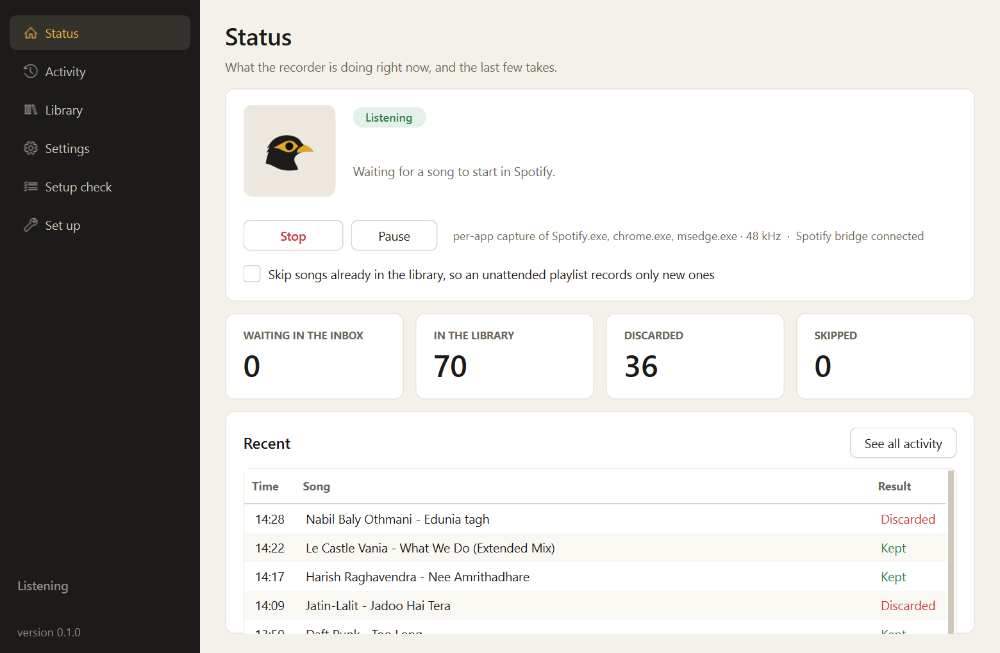

The top card shows the song being recorded.

| Part | What it shows or does |
|---|---|
| **Mynaphone can't hear Spotify** | A card above the others, shown when a song has played for 15 seconds and no sound has reached Mynaphone. It says the likely cause and what to do, and it goes away when sound comes back. See [the warning's causes](troubleshooting.md#mynaphone-cant-hear-spotify) |
| State pill | Stopped, Listening, Recording or Paused |
| Cover, title and artist | The song being recorded, with its album. With no song, the myna mark in the recorder's state |
| Progress line and time | How far into the song the take is, against the song's length |
| **Start** / **Stop** | Starts or stops the recorder. Stopping ends a take in progress, which is then discarded |
| **Pause** / **Resume** | Keeps listening but starts no new take until you resume. A take already running carries on |
| Capture line | The capture method, the sample rate, and whether the Spotify bridge is connected |
| **Skip songs already in the library** | Harvest mode. When an archived song starts, Spotify is told to skip to the next one |
| **Record a playlist** | Opens the dialog below. While a playlist records, the button reads **Stop the playlist** and the line beside it shows how many songs are saved and how many are left |
| **Wanted albums** | Opens the [Wanted albums window](#the-wanted-albums-window). Its label counts the albums on your Wanted list, such as **47 wanted albums** |

Under the card, 4 counts:

| Count | Meaning |
|---|---|
| Waiting in the inbox | Kept takes not yet identified and filed, for example while the internet is down |
| In the library | Songs filed in your library |
| Discarded | Takes that failed a check |
| Skipped | Songs that weren't recorded, for example because they were already in the library, longer than 15 minutes, or played before capture was running |

**Recent** lists the last 6 takes. **See all activity** opens the Activity page.

When a song didn't record all the way through and your library still doesn't have it, **Recent** also shows a
button such as **11 songs to play again**. It opens the list of those songs, with why each one didn't record and
when it last tried. **Open in Spotify** opens the song you picked, or a Spotify search for it when it was recorded
before the Spotify bridge connected. Play it again and Mynaphone records it. **Hide from the list** takes a song you
skipped on purpose off the list for good.

### The Record a playlist dialog

The list shows your Spotify playlists, with **Liked Songs** first, and how many songs each holds. You
can also paste a link to any Spotify playlist or album. Pick one and the line under the list says how
many of its songs are in your library, how many are left to record, and how many Spotify can't play
where you are.

| Button | What it does |
|---|---|
| **Save the playlist file** | Writes the playlist to the library's `Playlists` folder, without recording anything |
| **Record the missing songs** | Plays the playlist in Spotify from the first song your library doesn't have, and records the missing ones |

### The Wanted albums window

The list holds the albums you don't have every song of and have 3 or more songs from, plus any you added
with **Want this album**. The albums with the fewest songs left to record come first. The line above the
list counts the albums and their missing songs, and says how long Spotify takes to play those songs.

On the right is the album you picked, the same as in the [Albums view](#the-albums-view) of the Library.

## Activity

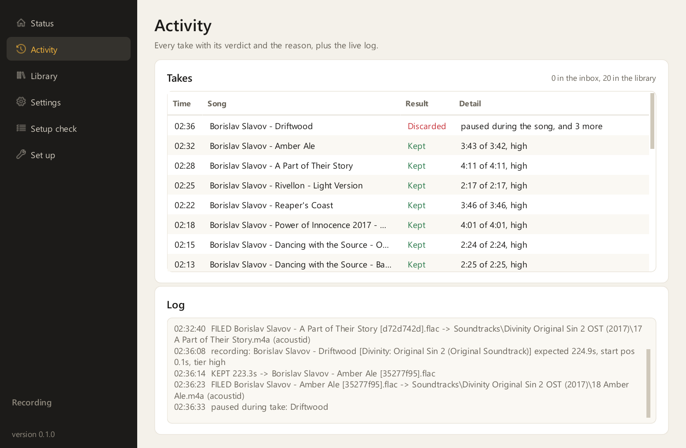

**Takes** lists every take, newest first, with the inbox and library counts at the top right.

| Column | What it shows |
|---|---|
| Time | When the take started |
| Song | Artist and title as the source app reported them |
| Result | Kept, Discarded, Skipped, Filed or Duplicate |
| Detail | For Kept, the recorded length against the song's length and the quality tier. For Discarded or Skipped, the reason; rest the mouse on it for the full list. For Filed, the place in the library, how the song was identified and what's still missing. For Duplicate, the library file that already holds the same recording |

**Log** shows the recorder's log as it's written, for the current session. The full log is in the
log folder, `D:\Music\mynaphone\logs` by default.

## Library

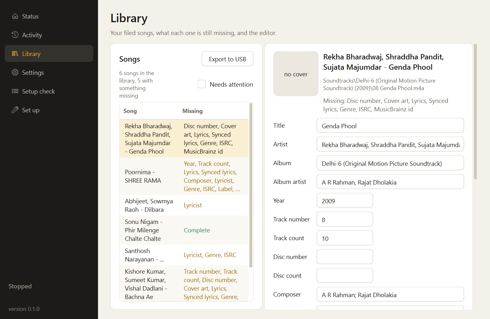

On the left, **Songs** lists every filed song with what it's still missing. "Complete" means nothing
is missing.

| Control | What it does |
|---|---|
| **Songs** / **Albums** | Switches the list between your songs and the albums they come from |
| Song count | How many songs are in the library and how many have something missing |
| **Needs attention** | Lists only songs with something missing, including those in `Unsorted` |
| **Export to USB** | Opens the [export dialog](#export-to-usb-dialog) |
| Search box | Lists only the songs with every word you type somewhere in their title, artist, album, or album artist, accents or not, and the song count says how many match. Esc clears the box, and the first song it found opens when you press the down arrow or Enter |

On the right, the editor shows the selected song: its cover, its path inside the library, the list
of missing details, and every field.

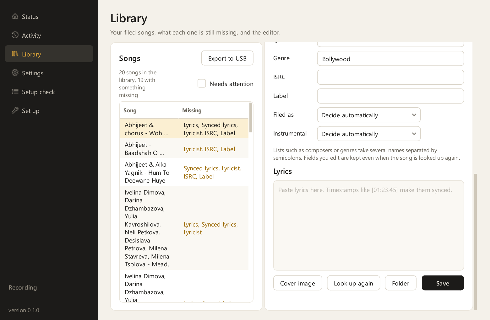

| Field | What to enter |
|---|---|
| Title, Artist, Album, Album artist | Text. For a film song, the singers go in Artist and the music director in Album artist |
| Year, Track number, Track count, Disc number, Disc count | Numbers |
| Composer, Lyricist, Genre | One or more names, separated by semicolons |
| ISRC, Label | Text |
| **Filed as** | Decide automatically, Soundtrack, Album, Single or Compilation. Sets the folder layout |
| **Instrumental** | Decide automatically, Yes, no vocals, or No, it has vocals. An instrumental needs no lyrics or lyricist |
| **Lyrics** | Plain lyrics, or synced lyrics with timestamps such as `[01:23.45]` at the start of each line |

A field you edit gets a blue border, and later lookups never overwrite it. An album artist you type
for a film song goes on every song in the film's folder.

| Button | What it does |
|---|---|
| **Cover image** | Choose a picture file as the song's cover |
| **Look up again** | Fingerprint the file again and query AcoustID, MusicBrainz and the lyrics sources, keeping your edits |
| **Folder** | Open the folder that holds the file in File Explorer |
| **Save** | Write your changes into the file's tags, and move the file if its folder name changed |

### The Albums view

**Albums** lists the albums your songs come from, with how many of each album's songs you have, such as
5 of 7. **Incomplete** lists only the albums you don't have every song of. Pick an album to see it on the
right.

| Part | What it shows or does |
|---|---|
| Count | How many of its songs you have, and how many more you have from another edition of it |
| Wanted list line | Whether the album is on your Wanted list, and why |
| **Record the missing songs** | Plays the album in Spotify from the first song you don't have, and records the missing ones |
| **Want this album** / **Take it off the Wanted list** | Puts the album on your Wanted list, or keeps it off |
| **Open in Spotify** | Opens the album in Spotify |
| **Songs** | Every song of the album, and whether it's in your library, missing, or one Spotify can't play where you are. Mynaphone reads them from Spotify when you pick the album, which needs the recorder running and Spotify open. Until then, the list shows the songs you have |

## Settings

The Settings page is one long scrolling page in 4 cards. Select **Save settings** at the bottom to
keep your changes. The [settings reference](settings.md) has every setting with its default and the
matching line in `config.toml`.

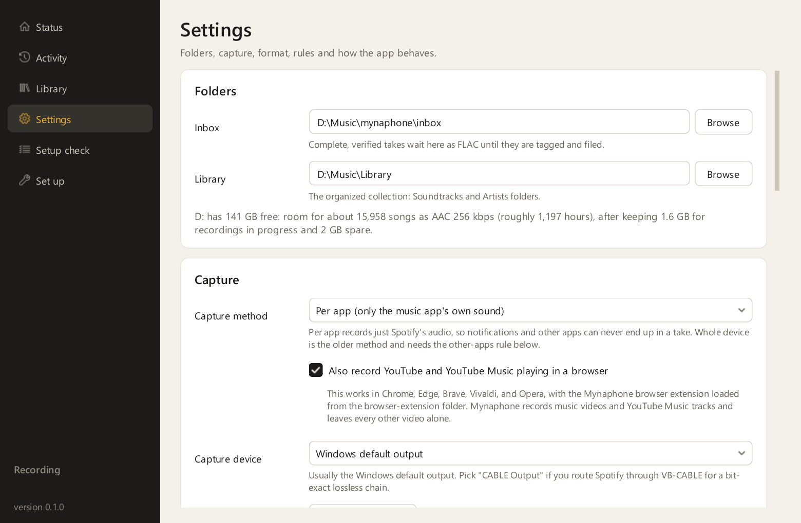

| Card | What's in it |
|---|---|
| Folders | The inbox and library folders, and how many songs fit on the library's drive |
| Capture | Capture method, YouTube recording, capture device, bit depth and library format |
| What counts as a complete song | Minimum length, the discard rules, re-recording at a higher tier, harvest mode and how long rejected takes are kept |
| Application | How the app starts, closes and shows tooltips |

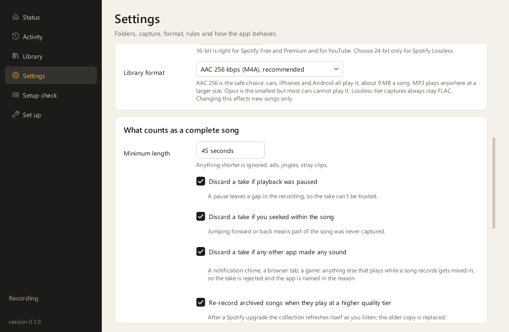

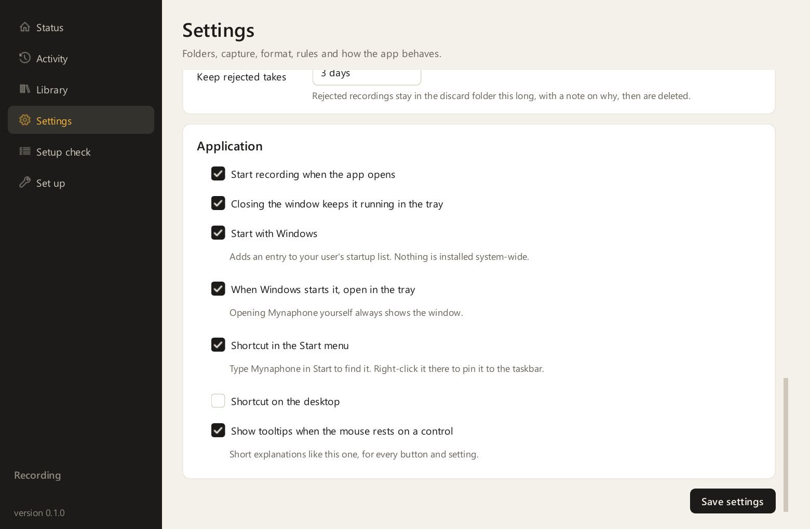

## Setup check

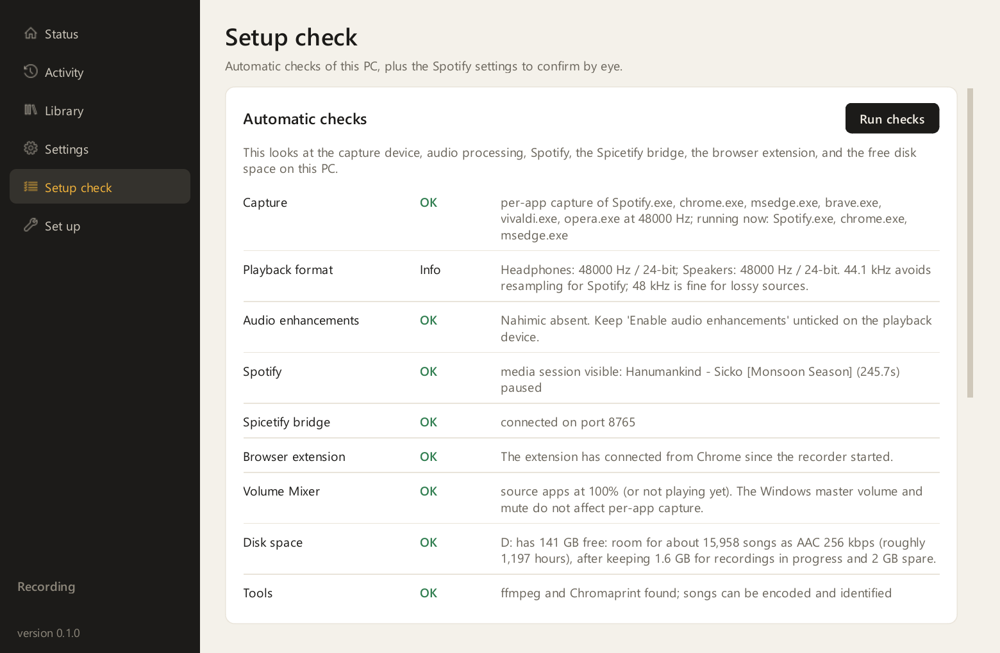

**Run checks** looks at the PC and lists one line per check, each marked OK, Info, Check or Problem.

| Check | What it looks at |
|---|---|
| Capture | Whether per-app capture can attach to each source app, and which ones are running |
| Playback format | Each output device's sample rate and bit depth |
| Audio enhancements | Audio processing such as Nahimic that alters the sound before capture |
| Spotify | Whether Spotify reports what it's playing to Windows |
| Spicetify bridge | Whether the Spotify bridge is installed and connected |
| Browser extension | Which browsers the extension connected from since the recorder started |
| Volume Mixer | Whether each source app's slider in the Windows Volume Mixer is at 100 % |
| Disk space | Free space on the library's and inbox's drives, and how many songs fit |
| Tools | Whether ffmpeg and Chromaprint are present |

**Confirm once in Spotify** lists the Spotify settings that can't be read from outside the app.
[Step 7 of the install guide](install.md#step-7-run-the-setup-check) has the table.

## Set up

The first-run page, with 4 numbered cards. Each one shows Done when finished. The window opens on
this page until the tools are in place and the AcoustID key is saved, and it stays in the sidebar afterwards.
[Step 4 of the install guide](install.md#step-4-start-the-app-and-open-the-set-up-page) describes
each card.

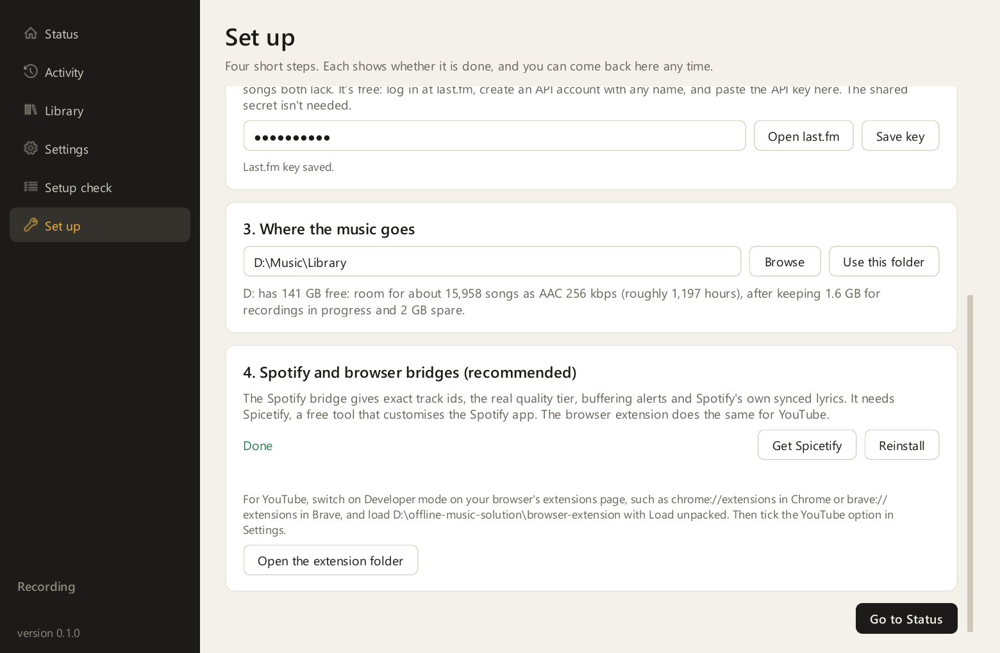

## Export to USB dialog

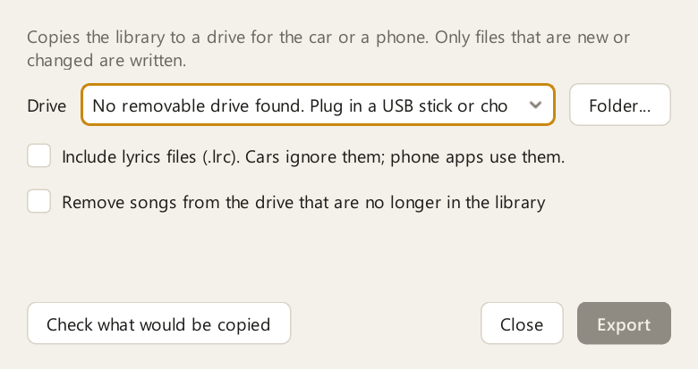

| Control | What it does |
|---|---|
| Drive | The removable drives plugged in. **Folder...** picks any folder instead, for example a phone's music folder |
| **Include lyrics files (.lrc)** | Also copies the `.lrc` file next to each song. Cars ignore them; phone apps use them |
| **Remove songs from the drive that are no longer in the library** | Makes the drive an exact mirror of the library |
| **Check what would be copied** | Shows how many files would be copied and how much space they need, how many are already up to date and how many would be removed, without writing anything |
| **Export** | Copies new and changed files |

## The tray icon and its menu

Mynaphone keeps running in the notification area when you close the window. The myna's eye shows
the recorder's state.

| Icon | State |
|---|---|
|  | Stopped |
|  | Listening for a song |
|  | Recording a song |
|  | Paused |

Click the icon to show or hide the window. Right-click it for the menu.

When Mynaphone can't hear a song, Windows shows one notification with the cause, and until sound
comes back the icon's tooltip reads **Mynaphone can't hear Spotify**. Click the notification to open
the window.

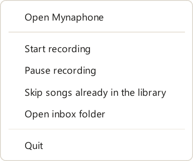

| Menu item | What it does |
|---|---|
| **Open Mynaphone** | Brings the window back |
| **Start recording** / **Stop recording** | Same as **Start** and **Stop** on the Status page |
| **Pause recording** | Same as **Pause** on the Status page |
| **Skip songs already in the library** | Turns harvest mode on or off |
| **Open inbox folder** | Opens the inbox in File Explorer |
| **Quit** | Stops the recorder and closes Mynaphone |

## Keyboard shortcuts

These keys work while the window is open and in front, and each control's tooltip shows its key.

| Keys | What they do |
|---|---|
| Ctrl+1 to Ctrl+6 | Open Status, Activity, Library, Settings, Setup check, and Set up, in the sidebar's order |
| Ctrl+R | Start or stop the recorder, like **Start** and **Stop**. Stopping mid-song discards that take |
| Ctrl+P | Pause or resume, like **Pause** and **Resume** |
| Ctrl+H | Turn harvest mode on or off, like **Skip songs already in the library** on the Status page |
| Ctrl+F | Open the Library's **Songs** view with the cursor in its search box |
| Ctrl+S | Save the song open in the Library editor, or your settings on the Settings page |
| F5 | Run the checks on the Setup check page |

Windows and the text boxes in the window leave these keys alone, so they work while you type in a field
too. A key does nothing while its button is greyed out, such as Ctrl+P while the recorder is stopped.
Alt+F4, Windows' own key, closes the window the way its X button does.
